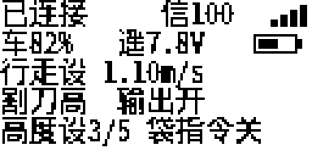

# FS-i6X 中文精简界面 — 2026-10-13

状态：遥控器发布构建、主机回归及像素布局检查通过；未刷写设备，实机验收待完成。
本次仅修改遥控器界面和只读数据呈现，不修改底盘控制板代码、通信协议、通道输出、模型存储格式或割刀授权状态机。底盘无需重新刷写。

## 固件与界面

- `fs-i6x-simple-ui.bin`：本次遥控器候选固件，129424 字节。
- `fs-i6x-simple-ui.elf`：对应调试和追溯文件。
- `rollback/fs-i6x-mower-v1.bin`：原 2026-10-08 已验收遥控器发布镜像的完整副本，原包保持不变。它不是从当前设备读出的备份；刷写前仍应保留设备当前镜像及模型。
- `SHA256SUMS`：交付文件校验；`validation/SOURCE-SHA256SUMS`：本次界面源码、测试与构建入口指纹。
- `preview/`：实际生产绘制函数和固定字库生成的主机预览，使用注入的模拟数据，不能作为硬件反馈证据。

日常只显示一个中文主界面：连接状态及信号、整车电量及遥控器电压、行走速度设定、割刀档位及输出、刀盘高度设定及草袋指令。



主界面短按上下左右不再切换到旧 DATA、FAULT、通道或计时器页。长按右键打开维护入口，上下选择，短按 OK 进入；“调试信息”上下滚动，“系统设置”“模型设置”保留原英文菜单和校准能力。EXIT 从调试返回维护，再返回主界面。每次开机完成必要的安全检查和校准后进入主界面。

## 显示含义

| 显示 | 含义 |
|---|---|
| 已连接 | 收到有效底盘状态，当前有效故障字为零；不代表已解锁或允许运行 |
| 未连接 | 没有新鲜底盘状态；接收机 RSSI 单独存在也不显示已连接 |
| 报错 | 在线且故障字非零，详细原因在调试界面 |
| 状态未知 | 已有部分底盘状态，但有效故障字缺失 |
| 行走设 | CH10 实际发送值对应的连续速度设定，0.40～1.80 m/s；不是实际车速 |
| 割刀低/中/高，输出开/关 | 现有底盘运行回显中的采用档位及输出使能；不是机械转动或停转证明 |
| 高度设 1～5/5 | CH9 的本地设定，沿用底盘五档阈值和滞回；不是实际高度或厘米值 |
| 袋指令开/关 | CH6 本地开合指令；不是草袋连接、到位或完成状态，中间及无效输入显示未知 |
| 车 xx% | 整车 SOC 回传；BMS 失效、反馈过期或缺失时显示 `--%` |
| 遥 x.xV | 遥控器自身电压；电池图标按原配置的电压范围绘制，不新增百分比估算 |

失联时隐藏信号数值及割刀运行回显。底盘会以零值回传失效的数据源，本版利用现有故障位将无效电量、电压、实际车速和割刀转速显示为 `--`；故障字缺失时也不把这些零值当作有效测量。

调试界面包含电量、电压、设定/实际速度、可用割刀转速、档位/输出、设定指令、运行许可、链路状态、确认事务、停刀回执及原始故障字。全部十个已定义故障位都提供中文名称与 `!`/`-`/`--` 标记，无故障历史记录。

割刀启动仍须按原流程操作 CH4 并短按 OK。出现确认弹窗时导航让位；从维护入口发生的新提示先回到主界面，菜单选择 OK 不复用为割刀确认。长按 MENU/OK 的释放事件被抑制，不授权启动。EXIT 不取消割刀指令，停刀继续使用原 CH4 回中流程。后台取消事务切页后继续运行；“等待停刀”“停刀无回执”是协议确认状态，不是机械停转证据。

## 验证与资源

- 中文生产界面测试直接执行当前 live provider、主界面路由、字库和绘制函数；覆盖新鲜/缺失/重复/过期遥测、底盘数据源故障位、模型通道中心值、端点及反向输出、CH6 指令边界、CH9 全范围和既有底盘解码的一致性。
- 原割刀确认/取消/迟到回执回归保留；新增维护 OK、长按释放、弹窗优先、调试滚动和像素边界检查，使用 AddressSanitizer/UndefinedBehaviorSanitizer。
- 全部 host harness 和遥控器 ARM 发布构建通过。日志在 `validation/`。macOS 的空 Mach-O 翻译单元含编译器 `ltmp` 标签，运行旧测试时仅用临时 nm 包装器过滤此类标签，生产代码和原测试入口未因此修改；包装器及复现说明随验证记录保存。
- Flash：129424/131072 字节，剩余 1648 字节。RAM 报告：15672/16384 字节，剩余 712 字节，包含原有栈预留。链接器仍报告现有 RWX LOAD 段警告，本次没有改链接脚本。
- mock、自动测试模型及 EXP3/PWM 台架开关关闭；现有 MOWER/OK 生产协议开启。未执行 SVN 提交。

仅构建遥控器：

```bash
# 从项目根目录执行；MOWER_UI_PYTHON 指向带 Pillow 的 Python 3。
MOWER_UI_PYTHON=/path/to/python3 ./tools/build_mower_user_ui.sh
```

正常构建直接使用已保存的中文字库，无需联网或重新生成字体。刷写和实机验收见 [刷写与复测说明](刷写与复测说明.md)。
