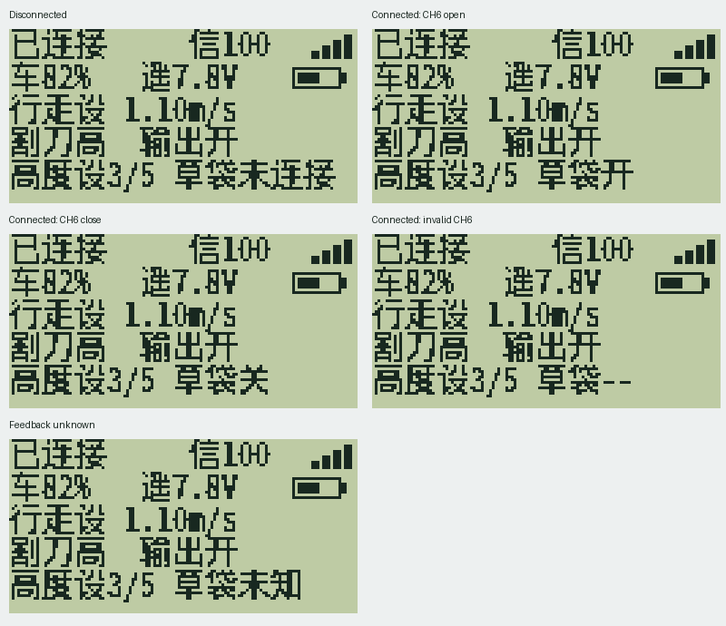

# 草袋连接状态显示 — 2026-10-21

状态：软件验证通过，硬件待复测。已生成底盘和 FS-i6X 两端候选固件；未烧录设备、未提交 SVN。

## 使用行为

| 条件 | 首页显示 |
|---|---|
| 底盘有效反馈草袋未连接 | 草袋未连接，拨 CH6 不改变此提示 |
| 草袋已连接，CH6 约 1000 / 2000 | 草袋开 / 草袋关 |
| 草袋已连接，CH6 中间值或无效值 | 草袋-- |
| 没有连接反馈、反馈过期或旧底盘不支持 | 草袋未知 |

“开/关”表示 CH6 的本地目标指令，不表示底盘接受、机械动作完成或到位。主界面顶行“已连接”仍表示整车遥测连接，和草袋是否安装是两件事。调试页分别查看“草袋指令”和“草袋连接”。



## 固件

完整功能需要更新两端。使用本包的生产固件，不使用 Debug 或台架配置。

| 文件 | 用途 |
|---|---|
| `fs-i6x-bag-connection.bin` | FS-i6X 遥控器，129884 字节 |
| `fs-i6x-bag-connection.elf` | 遥控器调试与追溯 |
| `control-chassis-bag-connection.hex` | STM32F407 底盘，包含烧录地址 |
| `control-chassis-bag-connection.elf` | 底盘 ST-Link/OpenOCD 烧录与调试 |
| `control-chassis-bag-connection.bin` | 底盘原始镜像，81324 字节，基址 0x08000000 |

`SHA256SUMS` 校验本包全部交付文件；各固件大小和哈希另见 `validation/firmware-manifest.json`。`rollback/` 是之前发布包的候选镜像副本，不是从当前设备读取的备份，也不代表其硬件已验收；刷写前仍须保存设备当前镜像和遥控器模型。

## 实现与兼容

底盘在现有运动任务的遥测采样路径直接读取 PD10（低电平表示连接），通过原子快照发布独立 SENS 地址 11 / 类型 0xE3。状态字包括连接、采样有效和 100ms 心跳；地址 1～10、CH6 动作、刀盘确认和安全联锁保持原有含义。

遥控器直接从经过 RF 校验的 AA/AC 数据读取该地址，无需依赖用户给传感器命名。首次接收只建基线，心跳推进后才显示连接状态；满 1 秒未推进即未知，重复旧包不能续期。重绑定清缓存，恢复须重新看到推进。同一心跳内断开优先，迟到的已连接包不能恢复旧状态。

新遥控器配旧底盘显示“草袋未知”；旧遥控器仍显示旧指令页面。实际接收机是否持续轮询第 11 个 SENS 地址和插拔显示延迟尚需实机验证。

协议说明：[SENS 草袋连接反馈](../../docs/protocols/sens-bag-connection.md)；决策记录：[独立传感器 ADR](../../docs/adr/0001-bag-connection-telemetry.md)。

## 软件验证与资源

- 完整主机回归通过：草袋控制/推杆、遥控授权、刀盘确认/取消、遥测快照、SENS、API 控制权及相关既有测试。
- 新测试覆盖实际 PD10 采样调用点：遥控离线、未授权和安全故障下仍采样；连接状态不依赖执行许可。模拟 GPIO，不是硬件测量。
- 新增 AA/AC、错误地址/类型/宽度、截断包、拔出重接、重复冻结包、1 秒边界、心跳/时间回绕和实际会话重绑定测试。
- 实际首页绘制/live provider 覆盖五种草袋显示、CH6 反复拨动与像素边界；新断言对修改前绘制器失败、修改后通过，使用 ASan/UBSan。
- 两端生产构建及底盘 Debug 构建通过。遥控器 Flash 129884/131072，剩余 1188；RAM 15680/16384，剩余 704（含既有栈预留）。底盘发布版 Flash 81324/524288，RAM 53360/131072。
- 新增代码无新增编译警告。底盘保留原有未使用变量/函数及 newlib syscall 链接警告；遥控器保留原有 RWX LOAD 段警告。修改过的底盘编译单元已与本次修改前副本对比诊断。
- `svn_preflight.sh` 通过；没有行尾整体改写或新增生产 `.c` 漏登记。

## 重现构建

从项目根目录执行。普通构建使用现有字库，无需下载字体。先准备 Arm GNU、CMake、Ninja 和带 Pillow 的 Python 3。

```bash
# macOS：仅对现有“空 Mach-O 单元的 ltmp 标签”测试兼容，见 validation/README.md。
./tools/verify.sh all
cmake --preset mower-ok-release -S control_chassis
cmake --build control_chassis/build/mower-ok-release
MOWER_UI_PYTHON=/path/to/python3 ./tools/build_mower_user_ui.sh
```

刷写与硬件验收步骤见 [刷写与复测说明](刷写与复测说明.md)。
